<div align="center">




<br/>


</div>

---

## 🩸 ПРОФАЙЛ

```yaml
name:      memfis
location:  Внутри твоей системы
role:      Backend-разработчик
status:    Ищу баги, 1000-7 и смысл в бесконечных коммитах
mode:      студент веб-разработки / ночной режим 24/7
```

---

## 🕷️ ARSENAL

<div align="center">


</div>

```yaml
[C#]      ====> core: ASP.NET Core · EF Core · MediatR / CQRS
[Python]  ====> scripts, API, фоновые задачи: DRF · FastAPI · Celery
[Infra]   ====> микросервисы · Docker Compose · Onion / Clean Architecture
```

---

## ЧТО Я ДЕЛАЛ

- **Бэкенд на работе** — внутренние сервисы на .NET и Python
- **Kvazar Games** — разработка сайта
- **Джарвис** — голосовой ассистент на Python: wake word, память в SQLite, обучаемые команды
- **Видеоплатформа** на .NET-микросервисах (загрузка → энкодинг → каталог)
- **PracticeBooking** — .NET-проект полного цикла

---

## СТАТИСТИКА ПУСТОТЫ

<div align="center">


</div>

---

## THE VOID

```yaml
Commits:     [ С Л И Ш К О М  М Н О Г О,  Я  Н Е  В Ы В О Ж У ]
Languages:   [ г у л ь с к о й ]
Total Views: [ true ghoul. ]
Dead Inside: [ 1000 - 7, сколько будет? ]
```

---

<p align="center">
  <i>« Тот, кто пытается во всем винить лишь этот мир — глубоко заблуждается.<br/>
  Мир не так плох... Его просто искажает то, что в нем находится. »</i>
</p>

